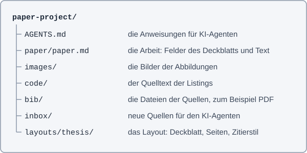

# Eidesstattliche Erklärung

Ich, Vorname Nachname, erkläre eidesstattlich, dass ich die Arbeit selbständig angefertigt habe. Es wurden keine anderen als die angegebenen Hilfsmittel benutzt. Die aus fremden Quellen direkt oder indirekt übernommenen Formulierungen und Gedanken sind als solche kenntlich gemacht. Diese schriftliche Arbeit wurde noch an keiner Stelle vorgelegt.

# Abstract

Ein Abstract ist eine prägnante Zusammenfassung der wesentlichen Inhalte der Masterarbeit. Es beinhaltet die übergeordnete Fragestellung (zentrale Forschungsfrage/n), eine Beschreibung der angewandten Methoden, eine kurze Darstellung der behandelten Themen, die wichtigsten Ergebnisse bzw. Erkenntnisse und die daraus abgeleiteten Schlussfolgerungen. Das Abstract im Ausmaß von max. einer A4-Seite wird in deutscher Sprache abgefasst.

# Vorwort

Will man persönliche Motive und Umstände der Arbeit näher beschreiben oder jemandem Dank sagen, so kann dies vor das Inhaltsverzeichnis gestellt werden – es wird nicht paginiert.

# Inhaltsverzeichnis

<!-- toc -->
- [1 Mit dieser Vorlage arbeiten](#mit-dieser-vorlage-arbeiten)
- [1.1 Was Sie brauchen](#was-sie-brauchen)
- [1.2 Die Ordner des Projekts](#die-ordner-des-projekts)
- [1.3 Das Deckblatt](#das-deckblatt)
- [2 Text schreiben](#text-schreiben)
- [2.1 Absätze und Hervorhebungen](#absätze-und-hervorhebungen)
- [2.2 Überschriften](#überschriften)
- [2.3 Formatvorlagen](#formatvorlagen)
- [2.4 Fußnoten](#fußnoten)
- [3 Abbildungen, Tabellen und Code](#abbildungen-tabellen-und-code)
- [3.1 Abbildungen](#abbildungen)
- [3.2 Tabellen](#tabellen)
- [3.3 Code](#code)
- [4 Quellen und Zitate](#quellen-und-zitate)
- [4.1 Zitationsrichtlinien](#zitationsrichtlinien)
- [4.2 Quellen sammeln](#quellen-sammeln)
- [4.3 Zitieren](#zitieren)
- [5 Mit KI arbeiten](#mit-ki-arbeiten)
- [5.1 Transparenter Einsatz von KI-basierten Tools](#transparenter-einsatz-von-ki-basierten-tools)
- [5.2 KI-Agenten im Projekt](#ki-agenten-im-projekt)
- [6 Notizen und Zusammenarbeit](#notizen-und-zusammenarbeit)
- [7 Seiten und PDF](#seiten-und-pdf)
- [7.1 Seiteneinstellungen](#seiteneinstellungen)
- [7.2 Seitenvorschau](#seitenvorschau)
- [7.3 Prüfen und formatieren](#prüfen-und-formatieren)
- [7.4 PDF erstellen](#pdf-erstellen)
- [8 Sprache und Barrierefreiheit](#sprache-und-barrierefreiheit)
- [8.1 Geschlechtergerechtes Formulieren](#geschlechtergerechtes-formulieren)
- [8.2 Zur Barrierefreiheit von Dokumenten](#zur-barrierefreiheit-von-dokumenten)
- [Verzeichnisse](#verzeichnisse--)
- [9 Literatur/Quellen/Referenzen](#literaturquellenreferenzen)
- [10 Abbildungsverzeichnis](#abbildungsverzeichnis)
- [11 Tabellenverzeichnis](#tabellenverzeichnis)
- [12 Abkürzungsverzeichnis](#abkürzungsverzeichnis)
- [Anhang](#anhang)
<!-- /toc -->

# Mit dieser Vorlage arbeiten

Diese Datei ist die leere Arbeit der Vorlage für Abschlussarbeiten der Pädagogischen Hochschule Tirol (PHT), in Markdown geschrieben. Die Vorlage basiert auf den Richtlinien zur Erstellung von Abschlussarbeiten in Aus-, Fort- und Weiterbildung an der Pädagogischen Hochschule Tirol und kann auch für Seminararbeiten verwendet werden.

Das Deckblatt, die Eidesstattliche Erklärung, das Abstract und das Vorwort haben die Texte der Word-Vorlage der PHT. Die Kapitel 1 bis 8 erklären, wie Sie mit dieser Datei arbeiten. Ersetzen Sie diese Kapitel durch den Text Ihrer Arbeit. Die Datei `document.pdf` im Ordner des Layouts zeigt die Seiten dieser Datei als PDF. Die Tasten in dieser Datei gelten für Windows und Linux; auf einem Mac drücken Sie Cmd statt Strg.

## Was Sie brauchen

- [Visual Studio Code](https://code.visualstudio.com/) (VS Code), einen freien Editor für Windows, macOS und Linux.
- Die Erweiterung [nimblescape Markdown Paper](https://github.com/nimblescape/markdownpaper-vscode) für VS Code. Sie zeigt die Seiten der Arbeit in der Vorschau, prüft die Datei und erstellt das PDF.
- Die Erweiterung [nimblescape Markdown Notes](https://github.com/nimblescape/markdownnotes-vscode) für VS Code. Sie verwaltet Notizen, Fußnoten, Abbildungen, Tabellen und Listings und formatiert die Datei.
- Google Chrome, Chromium oder Microsoft Edge. Markdown Paper druckt das PDF mit einem dieser Browser.
- [Node.js](https://nodejs.org/) ab Version 22, nur für die Befehle in der Kommandozeile, zum Beispiel für einen KI-Agenten.
- [Git](https://git-scm.com/) und ein Konto bei [GitHub](https://github.com/), wenn Sie die Versionen der Arbeit speichern oder mit anderen Personen zusammenarbeiten.

## Die Ordner des Projekts

Ein Projekt ist ein Ordner mit der Arbeit und allem, was sie braucht. Der Befehl `npx -y @nimblescape/markdownpaper create` in der Kommandozeile oder „Markdown Paper: New Project“ in VS Code legt ein neues Projekt an. Beide fragen nach dem Layout und bieten die Layouts auf GitHub zur Auswahl an. [Abbildung 1](#fig-ordner-projekts) zeigt die Ordner.

Abbildung 1: Die Ordner eines Projekts <a id="fig-ordner-projekts"></a>



Öffnen Sie den Ordner des Projekts in VS Code („Datei“, „Ordner öffnen“) und dann die Datei `paper/paper.md`.

## Das Deckblatt

Das Deckblatt entsteht aus den Feldern am Anfang der Datei, dem Kopf zwischen den zwei Zeilen `---`. Schreiben Sie in jedes Feld den Wert nach dem Doppelpunkt, in Anführungszeichen:

```yaml
title: "Lernen mit Feedback in der Berufsschule"
author: "Vorname Nachname"
date: "1. Juni 2026"
```

Die Zeile mit `#` über jedem Feld beschreibt das Feld. Wenn der Mauszeiger in VS Code über dem Namen eines Feldes steht, zeigt VS Code diese Beschreibung. Einige Felder haben eine Liste von Werten:

- `type`: Seminararbeit, Abschlussarbeit, Bachelorarbeit oder Masterarbeit. Der Wert steht über dem Titel.
- `kapitelumbruch`: `ja`, wenn jedes Kapitel auf einer neuen Seite beginnt, sonst `nein`.
- `variante`: `vorlage` für das Aussehen der Word-Vorlage der PHT, `klassisch` für das Aussehen früherer Arbeiten mit Times New Roman.

Ein Feld ohne Wert oder mit einem Wert, der nicht in der Liste steht, unterstreicht VS Code gelb. Die Ansicht „Probleme“ (Strg+Umschalt+M) zeigt alle Warnungen. Der Name der PDF-Datei entsteht aus den Feldern `matrikelnummer`, `author`, `lehrveranstaltung` und `type`.

# Text schreiben

Die Arbeit ist eine Textdatei in Markdown. Markdown ist eine einfache Schreibweise für Text: Zeichen wie `#`, `*` und `-` zeigen, was eine Überschrift, eine Hervorhebung oder eine Aufzählung ist. GitHub zeigt die Datei als Text mit Überschriften, und Markdown Paper macht daraus die Seiten nach dem Layout der PHT.

## Absätze und Hervorhebungen

- Schreiben Sie jeden Absatz in eine Zeile. Eine leere Zeile trennt zwei Absätze.
- `**fett**` wird **fett**, `*kursiv*` wird *kursiv*.
- Eine Zeile, die mit `- ` beginnt, ist ein Punkt einer Aufzählung mit Symbol. Eine Zeile, die mit `1. ` beginnt, ist ein Punkt einer Aufzählung mit Kleinbuchstaben: a), b), c).
- Eine Zeile, die mit `> ` beginnt, ist ein Blockzitat.
- Die Silbentrennung macht Markdown Paper selbst, nach den Regeln der Sprache des Layouts. Schreiben Sie keine Trennstriche.

## Überschriften

`#` ist ein Kapitel, `##` ein Abschnitt und `###` ein Unterabschnitt. Markdown Paper nummeriert sie: 1, 1.1, 1.1.1. Schreiben Sie keine Nummern. Eine Überschrift mit `{-}` am Ende bekommt keine Nummer, zum Beispiel `# Verzeichnisse {-}`.

Einige Überschriften erkennt Markdown Paper an ihren Wörtern: Eidesstattliche Erklärung, Abstract, Vorwort, Inhaltsverzeichnis, Abbildungsverzeichnis, Tabellenverzeichnis, Listingverzeichnis, Literaturverzeichnis und Anhang. Sie bekommen die Form der Vorlage. Die Seiten vor dem ersten Kapitel haben keine Seitenzahl, und das Inhaltsverzeichnis zeigt sie nicht.

Ein Verweis auf ein Kapitel ist ein Link mit einem Wort und einer Nummer, zum Beispiel `[Kapitel 3.1](#abbildungen)`: Der Text nach `#` ist die Überschrift in Kleinbuchstaben, mit `-` statt Leerzeichen. Die Seiten zeigen immer die aktuelle Nummer, zum Beispiel [Kapitel 3.1](#abbildungen). In VS Code schreibt der Befehl `/ref` solche Links: Tippen Sie `/ref` und wählen Sie das Ziel aus der Liste.

## Formatvorlagen

Das Layout enthält die Formatvorlagen für die Teile einer wissenschaftlichen Arbeit wie Fließtext, Überschriften und Einträge in das Inhaltsverzeichnis. Diese Formatvorlagen garantieren, dass gleiche Teile der Arbeit stets auch ein gleichartiges Aussehen haben. In der Datei genügt die Markdown-Schreibweise des Teils. [Tabelle 1](#tab-markdown-schreibweise-formatvorlagen) zeigt die Schreibweise und die Formatierung der wichtigsten Formatvorlagen in der Variante `vorlage`.

Tabelle 1: Die Markdown-Schreibweise der Formatvorlagen <a id="tab-markdown-schreibweise-formatvorlagen"></a>

| Markdown | Formatvorlage und Formatierung |
| --- | --- |
| Absatz ohne Zeichen | Standard (Fließtext): Arial 12 Pt.; Zeilenabstand 1,5; Absatzabstand nach 6 Pt.; Blocksatz |
| `# Kapitel` | Überschrift 1: Arial 16 Pt.; fett; Absatzabstand vor 12 Pt., nach 6 Pt.; linksbündig |
| `## Abschnitt` | Überschrift 2: Arial 14 Pt.; fett; Absatzabstand vor 12 Pt., nach 6 Pt.; linksbündig |
| `### Unterabschnitt` | Überschrift 3: Arial 12 Pt.; fett; Absatzabstand vor 12 Pt., nach 6 Pt.; linksbündig |
| `# Verzeichnisse {-}` | Titel, für Zwischenkapitel ohne Gliederung: Arial 16 Pt.; fett; Großbuchstaben; Absatzabstand nach 18 Pt.; linksbündig |
| `# Vorwort` | Überschrift ohne Nummer: Arial 16 Pt.; fett; Absatzabstand nach 12 Pt.; linksbündig |
| `> Zitat` | Blockzitat: Arial 12 Pt.; Zeilenabstand einfach; Absatzabstand nach 12 Pt.; Blocksatz; Einzug links und rechts 2 cm |
| `1. Punkt` | Aufzählung Kleinbuchstabe: Zeilenabstand 1,5; Blocksatz; hängender Einzug 0,75 cm |
| `- Punkt` | Aufzählung 1: wie Aufzählung Kleinbuchstabe, jedoch mit Symbol |
| `Abbildung 1: Text` | Beschriftung: Arial 10 Pt.; Zeilenabstand einfach; Absatzabstand nach 6 Pt.; Blocksatz |

## Fußnoten

Eine Fußnote hat einen Verweis im Text und ihren Text in einer eigenen Zeile:

```markdown
Die Interviews werden aufgezeichnet.[^1]

[^1]: Die Befragten stimmen der Aufzeichnung schriftlich zu.
```

Der Text der Fußnote steht unten auf der Seite des Verweises.[^beispiel] Markdown Paper nummeriert die Fußnoten in der Reihenfolge ihrer Verweise. In VS Code schreibt `/footnote` nach einem Wort eine neue Fußnote, und die Seitenansicht „Notes“ zeigt alle Fußnoten der Datei zum Lesen und Bearbeiten.

[^beispiel]: So sieht eine Fußnote aus.

# Abbildungen, Tabellen und Code

## Abbildungen

Eine Abbildung ist ein Bild in einem eigenen Absatz, mit ihrer Beschriftung im Absatz davor:

```markdown
Abbildung 1: Die Ordner eines Projekts <a id="fig-ordner-projekts"></a>


```

So fügen Sie eine Abbildung ein:

1. Legen Sie die Datei des Bildes in den Ordner `images/` des Projekts, zum Beispiel als PNG, JPEG oder SVG. In VS Code können Sie ein Bild auch mit gedrückter Umschalttaste in den Text ziehen oder aus der Zwischenablage einfügen; VS Code legt die Datei dann in das Projekt.
2. Tippen Sie in einer leeren Zeile `/figure` und wählen Sie das Bild aus der Liste. Markdown Notes schreibt die Beschriftung und das Bild.
3. Schreiben Sie den Text der Beschriftung. Die Nummer schreibt der Formatierer beim Speichern.
4. Schreiben Sie zwischen die eckigen Klammern einen Alternativtext: einen Satz, der das Bild für Personen beschreibt, die es nicht sehen.

Der Pfad in den runden Klammern führt von der Datei der Arbeit zum Bild. Das Layout setzt die Beschriftung über die Abbildung, wie APA 7 es verlangt. Der Anker `<a id="…">` am Ende der Beschriftung ist der Name der Abbildung für Verweise: `[Abbildung 1](#fig-ordner-projekts)` wird auf den Seiten zu [Abbildung 1](#fig-ordner-projekts), auch wenn sich die Nummer ändert. `/ref` schreibt solche Verweise und den Anker. Ein Bild ohne Beschriftung, zum Beispiel ein Logo, bekommt keine Nummer.

## Tabellen

Eine Tabelle besteht aus Zeilen mit `|` zwischen den Spalten. Die zweite Zeile trennt die Kopfzeile vom Inhalt. Die Beschriftung steht im Absatz direkt vor der Tabelle, und das Layout setzt sie über die Tabelle:

```markdown
Tabelle: Teilnehmende nach Schulstufe

| Schulstufe | Anzahl |
| --- | --- |
| 10 | 12 |
| 11 | 9 |
```

Tippen Sie in einer leeren Zeile `/table`: Markdown Notes schreibt eine Tabelle mit zwei Spalten und ihre Beschriftung. Die Nummer der Beschriftung schreibt der Formatierer, wie bei Abbildungen. Die Spalten müssen nicht genau untereinander stehen. [Tabelle 1](#tab-markdown-schreibweise-formatvorlagen) und [Tabelle 2](#tab-dokumentation-ki-basierter-hilfsmittel) sind Beispiele.

## Code

Kurzer Code steht in einem Codeblock zwischen zwei Zeilen mit drei Backticks. Der Name der Sprache nach den ersten Backticks färbt den Code in VS Code:

````markdown
```python
print("Hallo")
```
````

Code aus einer Datei des Projekts ist ein Listing mit Nummer und Beschriftung. Tippen Sie in einer leeren Zeile `/listing`, wählen Sie die Datei und dann die ganze Datei oder eine Funktion. Markdown Notes schreibt die Beschriftung mit einem Link zu den Zeilen der Datei, einen Kommentar mit der Quelle und den Code. Der Formatierer schreibt den Code bei jedem Speichern neu aus der Datei, so bleibt das Listing aktuell. Ändern Sie den Code des Listings deshalb in der Datei, nicht in der Arbeit. [Listing 1](#lst-mittelwert-noten) zeigt eine Funktion aus der Datei `code/mittelwert.py` des Projekts.

Listing 1: [Der Mittelwert der Noten](code/mittelwert.py#L1-L3) (mittelwert.py, L1-L3)<a id="lst-mittelwert-noten"></a>

<!-- listing: code/mittelwert.py#mittelwert -->

```python
def mittelwert(noten):
    """Gibt den Mittelwert einer Liste von Noten zurück."""
    return sum(noten) / len(noten)
```

Eine Überschrift `# Listingverzeichnis` bei den Verzeichnissen fügt die Liste der Listings hinzu.

# Quellen und Zitate

## Zitationsrichtlinien

Die Zitationsrichtlinien für Abschlussarbeiten sind auf der Website der PHT abzurufen. Tabellen und Abbildungen sind nach den Vorgaben in diesem Dokument zu formatieren. Das Layout zitiert im Stil APA 7 nach den Regeln der PHT. Das alphabetisch geordnete Literaturverzeichnis umfasst die gesamte verwendete Literatur der Arbeit.

## Quellen sammeln

Die Daten der Quellen stehen in einem Kommentar am Ende der Datei, den die Seiten und GitHub nicht zeigen. Jede Zeile ist eine Quelle mit ihrer ID, zum Beispiel `hattie2007`. Schreiben Sie diese Daten nicht selbst: Ein KI-Agent fügt eine Quelle mit dem Befehl `markdownpaper source` hinzu, der ihre Daten aus doi.org, aus den Katalogen der Bibliotheken, aus PubMed, aus arXiv oder von einer Webseite holt:

```sh
npx -y @nimblescape/markdownpaper source paper/paper.md 10.3102/003465430298487
```

Legen Sie die Datei einer Quelle, zum Beispiel ein PDF, in den Ordner `inbox/`. Ein KI-Agent liest sie, ergänzt ihre Daten und legt sie mit der ID als Namen in den Ordner `bib/`, zum Beispiel `bib/hattie2007.pdf`.

## Zitieren

Ein Zitat ist ein Link auf die ID der Quelle. Der Titel des Links in Anführungszeichen nennt die Stelle in der Quelle:

```markdown
Feedback wirkt stark auf das Lernen ([Hattie & Timperley, 2007, S. 81](#hattie2007 "page 81")).
[Hattie und Timperley (2007)](#hattie2007 "narrative") beschreiben vier Ebenen.
```

Feedback wirkt stark auf das Lernen ([Hattie & Timperley, 2007, S. 81](#hattie2007 "page 81")). Den Text jedes Zitats und die Einträge des Literaturverzeichnisses schreibt der Formatierer beim Speichern, im Zitierstil des Layouts. Ein Zitat einer Quelle ohne Daten unterstreicht VS Code gelb.

Damit ein KI-Agent die Quellen für ein Argument sucht, markieren Sie das Argument und tippen `/research`. Das Argument bekommt davor eine verborgene Marke und an seinem Ende `(RESEARCH)`. Der Agent sucht Quellen, die das Argument stützen, ergänzt sie und setzt ihre Zitate an die Stelle von `(RESEARCH)`. Bis dahin zeigen die Seiten `(RESEARCH)`, und VS Code unterstreicht es gelb.

# Mit KI arbeiten

## Transparenter Einsatz von KI-basierten Tools

Der Einsatz von KI-basierten Tools in Abschlussarbeiten an der PHT verlangt nach sorgfältiger Dokumentation und Transparenz. Beachten Sie jedoch, textgenerierende KI-Tools werden nicht als zitierfähige wissenschaftliche Quellen an der PHT anerkannt (z. B. bei direkten Zitaten oder in-Text-Verweisen). Tools wie DeepL für Übersetzungen oder ChatGPT für Brainstorming dürfen ausschließlich als unterstützende Hilfsmittel verwendet werden. Am Ende der Arbeit ist analog zu dem Literaturverzeichnis eine Liste mit genutzten Tools oder Hilfsmitteln beizufügen. Eine detaillierte Dokumentation im Anhang sichert die Nachvollziehbarkeit und erhält die wissenschaftliche Integrität. Eine kontinuierliche Dokumentation während des Arbeitsprozesses, welche Tools in welchen Abschnitten verwendet wurden, ist daher empfehlenswert. Ein Beispiel liefert [Tabelle 2](#tab-dokumentation-ki-basierter-hilfsmittel):

Tabelle 2: Beispiel einer Dokumentationstabelle (in Anlehnung an Bildungstechnologien der Universität Basel CC-BY-SA-4.0) <a id="tab-dokumentation-ki-basierter-hilfsmittel"></a>

| KI-basierte Hilfsmittel | Einsatzform | Betroffene Teile der Arbeit | Bemerkungen |
| --- | --- | --- | --- |
| DeepL Translator | Übersetzung von Textpassagen | Ganze Arbeit | |
| Chat GPT 4o (OpenAI) | Textglättung (Grammatik, Rechtschreibung, Sprachstil) | Ganze Arbeit | |
| | Chat GPT wurde zum Thema der Arbeit befragt, die Ergebnisse mit eigener Recherche verglichen. | Kapitel 2<br>S. 5. – 7 | |
| DALL-E | Erstellung von Visualisierungen | Abb. 2, S. 7<br>Abb. 9. S. 15 | Abb. 2, S. 7 stark überarbeitet, nur Visualisierungsidee von DALL-E |

## KI-Agenten im Projekt

Ein KI-Agent, zum Beispiel Claude Code oder GitHub Copilot, kann im Projekt Quellen suchen und ergänzen, die Dateien in `inbox/` bearbeiten, Text prüfen und das PDF erstellen. Die Datei `AGENTS.md` im Projekt nennt ihm die Befehle mit den Regeln dieser Datei:

```sh
npx -y @nimblescape/markdownpaper instructions document
npx -y @nimblescape/markdownpaper check paper/paper.md
npx -y @nimblescape/markdownpaper pdf paper/paper.md
```

Ein Agent darf die Daten einer Quelle nie aus seinem Gedächtnis schreiben, sondern nur aus doi.org, einem Katalog oder der Quelle selbst. Tragen Sie jeden Einsatz eines Agenten in die Dokumentationstabelle ein.

# Notizen und Zusammenarbeit

Markdown Notes fügt Notizen zu einer Stelle des Textes hinzu, zum Beispiel eine Frage an die Betreuerin oder eine Aufgabe für später. Eine Notiz ist eine Fußnote mit einer ID wie `note-7k2q` und einer Kopfzeile mit dem Namen und der Zeit. Die Seiten und das PDF zeigen keine Notizen. GitHub zeigt sie als Fußnoten am Ende der Datei.

- **Notiz hinzufügen:** Markieren Sie den Text und drücken Sie Umschalt+Alt+N, oder klicken Sie auf die Glühbirne und dann auf „Add Note“. Schreiben Sie die Notiz in der Seitenansicht „Notes“.
- **Antworten:** Jede Notiz ist ein Gespräch. Mehrere Personen können antworten, auch auf eine Antwort.
- **Aufgaben:** `/todo` am Ende eines Satzes schreibt eine Notiz mit einem Kästchen zum Abhaken.
- **Farben und Filter:** Jede Notiz hat eine Farbe. Die Filter der Seitenansicht zeigen nur die offenen Aufgaben, eine Farbe oder Notizen mit bestimmten Wörtern.
- **Name:** Mit der Anmeldung bei GitHub in VS Code trägt jede Notiz Ihren Namen bei GitHub.

Eine Datei mit Notizen öffnet VS Code in einer sauberen Ansicht, die den Text ohne die Zeichen der Notizen zeigt. Mit Git und GitHub speichern Sie jede Version der Arbeit und teilen sie mit der Betreuerin oder dem Betreuer.

# Seiten und PDF

## Seiteneinstellungen

Für dieses Dokument sind alle Seitenränder (linker Rand 3,5 cm, rechter/unterer Rand 2,5 cm und oberer Rand 3,0 cm) im Layout vordefiniert, die Fußzeile einschließlich der automatischen Seitenzahl wurde ebenfalls voreingestellt. Das Layout setzt auch die Seitenumbrüche und die Seitenzahlen: Die Seiten vor dem ersten Kapitel haben keine Seitenzahl, das erste Kapitel beginnt mit Seite 1, und der Anhang hat eigene Seitenzahlen. Als Schrift nutzt das Layout Liberation Sans, eine freie Schrift mit den Maßen von Arial.

## Seitenvorschau

Die Vorschau von VS Code zeigt die Seiten der Arbeit so, wie sie im PDF stehen. Drücken Sie Strg+K und dann V für die Vorschau neben dem Text, oder klicken Sie auf das Buch („Show Page Preview“) oben rechts im Editor. Die Vorschau folgt jeder Änderung nach einer kurzen Pause. Ein Doppelklick auf einen Absatz der Vorschau zeigt seine Zeile im Text.

## Prüfen und formatieren

VS Code prüft die Datei beim Schreiben und unterstreicht Probleme gelb: ein fehlendes Feld des Deckblatts, einen Verweis auf eine Abbildung, die es nicht gibt, oder ein Zitat ohne Quelle. Beim Speichern und mit „Dokument formatieren“ (Umschalt+Alt+F, unter Linux Strg+Umschalt+I) formatiert Markdown Notes die Datei: Es schreibt die Nummern der Beschriftungen und der Verweise, das Inhaltsverzeichnis, die Verzeichnisse der Abbildungen und Tabellen, die Zitate und das Literaturverzeichnis. Diese Teile schreiben Sie nie von Hand.

## PDF erstellen

Klicken Sie oben rechts im Editor auf das Menü „Ausführen“ und dann auf „Export PDF“, oder klicken Sie im Explorer mit der rechten Maustaste auf die Datei. Das PDF liegt danach neben der Datei. In der Kommandozeile macht das der Befehl:

```sh
npx -y @nimblescape/markdownpaper pdf paper/paper.md
```

# Sprache und Barrierefreiheit

## Geschlechtergerechtes Formulieren

Im Sinne der Gleichbehandlung und Repräsentation aller Geschlechter ist die Abschlussarbeit in geschlechtergerechter Sprache zu formulieren. Dies soll mittels neutraler Formulierung oder in Sparschreibung erfolgen. Konkrete Hinweise und Anleitung finden sie im jeweils aktuellen Sprachleitfaden der PHT.

## Zur Barrierefreiheit von Dokumenten

Wissenschaftliche Abschlussarbeiten sind laut Behindertengleichstellungsgesetz 2006 § 6 barrierefrei zu erstellen und einer Prüfung auf Barrierefreiheit zu unterziehen.

Die Metadaten Dokumentsprache und Titel sind zur Verfügung zu stellen. Blinde Menschen arbeiten oft mit einer Sprachausgabe-Software, einem sogenannten Screen-Reader. Screen-Reader können in verschiedenen Sprachen vorlesen. Für das Dokument muss festgelegt sein, in welcher Sprache es geschrieben ist, damit der Screen-Reader in der richtigen Sprache vorliest. Markdown Paper schreibt die Sprache des Layouts, den Titel und die Verfasserin oder den Verfasser in die Metadaten des PDF. Geben Sie jeder Abbildung einen Alternativtext ([Kapitel 3.1](#abbildungen)).

Die Gestaltung eines barrierefreien Dokuments wurde im Wiki der PHT dokumentiert.

# Verzeichnisse {-}

# Literatur/Quellen/Referenzen

<a id="hattie2007"></a>Hattie, J., & Timperley, H. (2007). The Power of Feedback. *Review of Educational Research, 77*(1), 81 – 112. https://doi.org/10.3102/003465430298487

# Abbildungsverzeichnis

<!-- lof -->
- [Abbildung 1: Die Ordner eines Projekts](#fig-ordner-projekts)
<!-- /lof -->

Ein Abbildungsverzeichnis ist erst ab der dritten Abbildung notwendig.

# Tabellenverzeichnis

<!-- lot -->
- [Tabelle 1: Die Markdown-Schreibweise der Formatvorlagen](#tab-markdown-schreibweise-formatvorlagen)
- [Tabelle 2: Beispiel einer Dokumentationstabelle (in Anlehnung an Bildungstechnologien der Universität Basel CC-BY-SA-4.0)](#tab-dokumentation-ki-basierter-hilfsmittel)
<!-- /lot -->

Ein Tabellenverzeichnis ist erst ab der dritten Tabelle notwendig.

# Abkürzungsverzeichnis[^abk]

| Abkürzung | Bedeutung |
| --- | --- |
| APA | American Psychological Association |
| PH | Pädagogische Hochschule |

[^abk]: Nur spezifische Abkürzungen anführen, keine allgemein üblichen wie beispielsweise „usw.“.

# Anhang

Verwendete Materialien z. B. Fragebögen (Vorlagen), Interviewleitfäden und Beobachtungsbögen sowie KI-Dokumentationstabelle werden im Anhang beigegeben.

Der Anhang wird nach einem Abschnittswechsel eingefügt und erhält eine eigenständige Seitennummerierung, da er nicht in den Umfang der Arbeit eingerechnet wird.

<!-- nimblescape-sources
{"id":"hattie2007","type":"article-journal","author":[{"family":"Hattie","given":"John"},{"family":"Timperley","given":"Helen"}],"issued":{"date-parts":[[2007,3]]},"title":"The Power of Feedback","container-title":"Review of Educational Research","container-title-short":"Review of Educational Research","volume":"77","issue":"1","page":"81-112","publisher":"American Educational Research Association (AERA)","ISSN":"0034-6543","DOI":"10.3102/003465430298487","language":"en"}
-->
